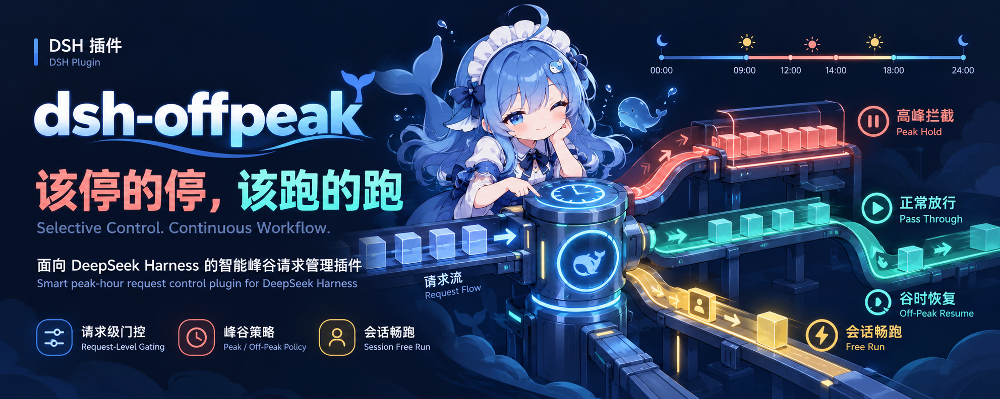

<p align="center">
  
</p>

# dsh-offpeak

一个 DSH（DeepSeek Harness）宿主插件：用来自动管理高峰期的会话与请求 —— 在高峰请求真正发出**之前**拉门、只拦**目标为官方源或显式列出的模型**的请求、其余照常跑，并支持给单个会话排一段时间「畅跑」豁免。

插件 id `dsh-offpeak`，设置命名空间 `offpeak`，配置文件 `config/offpeak.json`。

## 能力一览

| 能力 | 行为 |
|---|---|
| 可配置峰谷策略 | 峰窗口、时区、每窗口的星期与周末规则全部来自 `config/offpeak.json`（env → `$DSH_HOME/config` → `<cwd>/config` → 包内默认）。配置文件写坏**绝不静默让守卫失效**：错误被收集并暴露（`/session-guard/settings` 与 `/diag` 的 `configFile.errors`），对应键保留默认值。 |
| 回合 / step 门控 | 入峰时暂停 running 会话（`stepLevelPause` 开启则在下一个 `agent/pre-step` 拉门），退峰自动放行；自动放行**不碰**手动 `/pause`。 |
| 请求级守卫 | `agent/request` **每个请求都过**，所以入峰后才启动的会话、会话中途切到官方源的情况都能兜住。`hold`（默认）静默挂起，`error` 抛可识别的 `PEAK_DEFERRED`。 |
| 目标判定 | 优先级：显式 `officialProviders` → **模型名（精确匹配、大小写不敏感）** → 实时 `baseURL` → catalog 默认端点 → 内置 id（`deepseek-official`）→ unknown。只有判为官方才拦。 |
| 高峰拦截列表 | 在徽标面板里勾选模型（或直接写 `officialModelPatterns`）：条目是**模型名精确匹配** —— 勾了 `ocg/deepseek-flash` 就只拦这一个模型，无论它跑在哪条路由上；**不勾不拦**。面板顶部有关键词过滤、全选/取消全选、刷新与热重载，每个已拦截项都带 `×` 撤销。 |
| 畅跑 | 给单个会话排一段或多段绝对时间窗口，窗口内该会话在**入峰、step 门、请求挂起**三处都豁免；支持逐段暂停/恢复、合并上限 8 条、持久化。面板里与拦截列表同处一个展开区（最上方）。 |
| 徽标 | 输入区一个可点徽标：`高峰` / `高峰 · 拦截中` / `高峰 · 畅跑中` / `谷时` / `周末`；拦截态红、放行态绿。 |
| 自动重试 | 可选的后端重试（默认关），且永远给门控让路。 |

## 安装（源码方式）

```bash
git clone https://github.com/lizilong1993/dsh-offpeak.git
cd dsh-offpeak
npm install          # 或 pnpm install
npm run build        # 重新构建 lib/client.js（浏览器半）
```

推荐用插件管理器安装到某个 profile（它会顺带把 pnpm 依赖与 `dsh.profile.bundles` 调和好）：

```bash
dsh plugin --profile desktop add ./dsh-offpeak
dsh --profile desktop --dump-config     # 验证补丁分层
```

也可以手工在 profile 里指向这个检出 —— `~/.dsh/profiles/<profile>/package.json`：

```json
{ "dependencies": { "dsh-offpeak": "link:/path/to/dsh-offpeak" } }
```

并把 `dsh-offpeak` 加进同一文件的 `dsh.profile.bundles`；然后重启 DSH（host 代码在 boot 时加载）并刷新页面。

## 配置

`config/offpeak.json`（默认层；设置表单里的值优先），常用键：

```jsonc
{
  "timezone": "Asia/Shanghai",
  "peakPolicy": { "peakWindows": [{ "name": "morning", "start": "09:00", "end": "12:00", "days": ["mon","tue","wed","thu","fri"] }] },
  "weekendPolicy": { "enabled": true, "days": ["sat","sun"], "mode": "offPeak" },
  "providerGuard": true,
  "officialProviders": [],            // 追加官方 provider id（精确匹配，最高优先级）
  "officialModelPatterns": [],        // 高峰拦截的模型名（精确匹配、大小写不敏感）
  "officialBaseURLs": ["api.deepseek.com"],
  "deferredMode": "hold",             // 'hold' | 'error'
  "deferredResume": true,
  "stepLevelPause": true
}
```

可用 `DSH_OFFPEAK_CONFIG` 显式指定配置文件；状态目录默认 `.dsh/offpeak`（`DSH_OFFPEAK_STATE_DIR` 可覆盖）。

## HTTP / 服务面

`GET /session-guard/status` · `/state?session=` · `/settings` · `/provider?provider=&model=` · `/models` · `/diag` · `/events`（SSE）· `POST /session-guard/rpc`（`stopNextTurn|resume|lockQueue|unlockQueue|stepPause|stepResume|state|reloadConfig|setModelPatterns|freeRunAdd|…`），以及进程内的 `sessionGuard` 服务端口。

## 测试

`npm test`（node:test）· `npm run lint` · `npm run build`。

## 致谢

- [drscrewdriver/dsh-session-guard](https://github.com/drscrewdriver/dsh-session-guard)

## 许可

MIT —— 见 [LICENSE](./LICENSE)。
